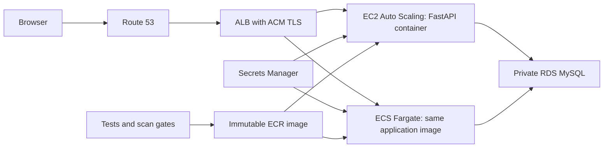
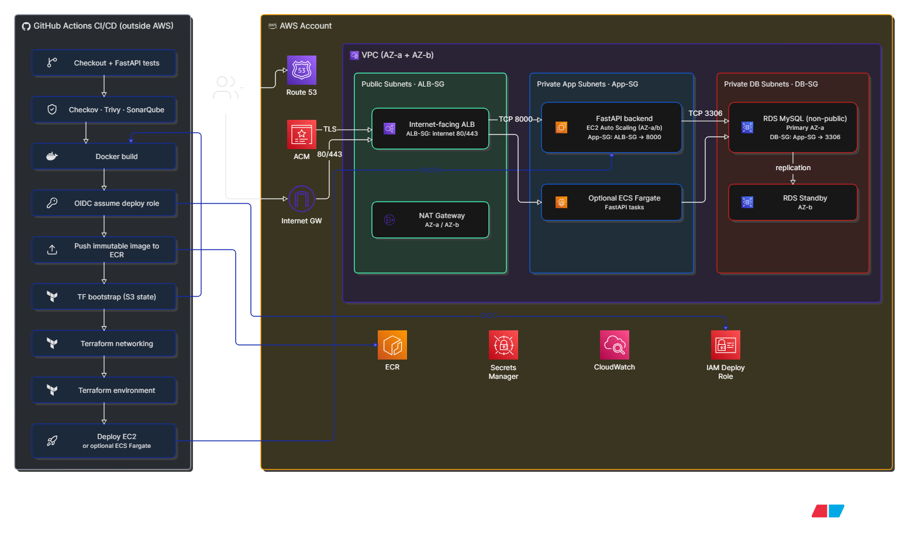

# AWS 3-Tier Application with Terraform and GitHub Actions

This repository demonstrates a repeatable AWS deployment for a FastAPI/MySQL application using EC2 Auto Scaling and ECS Fargate. Both deployments use the same tested Docker image behind an Application Load Balancer.

**Status: cloud environment torn down. Validation level: run on real cloud in a training account.** Historical publish and infrastructure-deploy failures remain visible because the environment is unavailable; they are not evidence of a currently running service. This PR runs offline CI, not a cloud rebuild.

## Architecture






```text
Internet → Route 53 → ACM → Application Load Balancer
                              ├── EC2 Auto Scaling Group → FastAPI container
                              └── ECS Fargate service    → FastAPI task
                                                            ↓
                                                   Secrets Manager → RDS MySQL
```

The VPC is split into public, application, and database subnets across two Availability Zones. The ALB is public; EC2, ECS, and RDS are private.

```text
Browser → ALB:80/443 → application:8000 → RDS MySQL:3306
```

The application serves a small static frontend and API from FastAPI. `/healthz` checks process health and `/readyz` checks database readiness.

## Repository layout

```text
.
|-- app/backend/             FastAPI application, Dockerfile, tests
|-- infra/terraform/         Shared VPC, ALB, RDS, EC2, IAM, alarms
|   |-- modules/alb/         Load balancer and target group
|   |-- modules/networking/  VPC, subnets, routes, NAT
|   `-- modules/security-groups/
|-- deploy/ecs/              ECS cluster, Fargate task, service, logs, alarms
|-- .github/workflows/       CI, image publication, deployment, load testing
|-- docs/                    Architecture and presentation material
`-- README.md                Project documentation
```

## Branches and environments

The project uses a branch-based, multi-environment CI/CD model:

- Feature branches are validated through pull requests into `main`.
- `main` is the deployable branch.
- Terraform supports `dev`, `test`, and `prod`.
- Infrastructure mutations are restricted to `main`.
- The deployment workflow is manually dispatched with a target (`networking`, `ec2`, or `ecs`), environment, and operation (`plan`, `apply`, or `destroy`).

## CI/CD and immutable images

`CI - Quality and Security` runs linting, pytest coverage, Terraform validation, Checkov, Trivy filesystem and secret scans, Docker health testing, image scanning, SBOM generation, and SonarQube analysis.

After successful CI on `main`, `Publish - Application Image` publishes the exact tested image to ECR as:

```text
sha-<commit-sha>
```

ECR uses immutable tags and scan-on-push. A lifecycle policy retains the 20 newest `sha-*` images. The CD workflow resolves the newest published immutable image and deploys that tag through Terraform.

Normal deployment order:

1. Bootstrap the Terraform state backend.
2. Apply `networking`.
3. Publish an image from `main`.
4. Apply `ec2` and/or `ecs` for the selected environment.
5. Run the HTTPS smoke test.

## Security model

- GitHub Actions uses OIDC; long-lived AWS keys are not stored in GitHub.
- RDS credentials are managed by Secrets Manager.
- EC2 and ECS use IAM roles to retrieve the secret and pull from ECR.
- The ALB security group accepts public HTTP/HTTPS traffic.
- The application security group accepts port `8000` only from the ALB security group.
- The database security group accepts MySQL port `3306` only from the application security group.
- RDS is private and encrypted; EC2 requires IMDSv2.

Security-group definitions are in [infra/terraform/modules/security-groups/main.tf](infra/terraform/modules/security-groups/main.tf).

## Observability

CloudWatch collects:

```text
/cloudbatch818/zein/<environment>/app   EC2 container logs
/cloudbatch818/zein/<environment>/ecs   ECS container logs
```

Application logs are retained for seven days. RDS exports `error`, `general`, and `slowquery` logs. Terraform defines alarms for ALB target 5xx responses, ALB p95 latency above one second, high EC2 CPU, high ECS CPU, and ECS running tasks below the desired count. ECS Container Insights is enabled.

The alarms currently have no SNS actions, so they monitor state but do not send email or Slack notifications.

## Rollback and recovery

- ECS has a deployment circuit breaker with rollback enabled.
- EC2 can be manually redeployed with a previous immutable `sha-*` image.
- Terraform changes are reviewed through plans; Terraform does not automatically roll back failed infrastructure changes.
- The current CD workflow selects the newest image automatically. An explicit `image_tag` input would improve controlled rollback.

## Cleanup

Destroy in reverse dependency order:

```text
ecs → ec2 → networking
```

Run and review a destroy plan before applying. Keep the bootstrap state bucket until all dependent states are removed. Confirm that no other environment uses the shared networking stack before destroying `networking`.

## Demo setup

Create a public Route 53 hosted zone and configure the `dev` GitHub Environment with values similar to:

```text
HOSTED_ZONE_NAME=example.com
EC2_DOMAIN_NAME=ec2-dev.example.com
ECS_DOMAIN_NAME=ecs-dev.example.com
ENABLE_NAT_GATEWAY=true
```

Keep AWS role, state bucket, region, subnet, instance, and domain values in GitHub configuration rather than committing them. For the load test, set `MIN_SIZE=1` and `MAX_SIZE=2` in `dev`, then run `Test - EC2 Load and Scaling` against an HTTPS API URL.

## Production-readiness notes

Before production use:

- Add SNS or another notification target to CloudWatch alarms.
- Add an explicit deployment image-tag input for controlled rollback.
- Review RDS backup retention, deletion protection, Multi-AZ, and final-snapshot settings.
- Review NAT Gateway cost and high-availability requirements.
- Add authentication, authorization, rate limiting, WAF rules, dashboards, and alert escalation if externally exposed.
- Add environment approvals and least-privilege production IAM policies.

These are intentional demo-scope trade-offs and should be part of a production hardening plan.

## Run and test locally

The backend defaults to a local SQLite database; this does not prove RDS, Secrets Manager or IAM integration.

```sh
cd app/backend
python -m venv .venv
# Activate the virtual environment for your shell, then:
pip install -r requirements-dev.txt ruff
SEED_DATA=true uvicorn main:app --reload
pytest --cov=. -q
ruff check .
```

See [backend setup](app/backend/README.md). CI also validates Terraform and builds/scans the container. No cloud credentials are needed for the unit-test path.

## Validation boundaries and trade-offs

One immutable image supports both EC2 and ECS so delivery behavior can be compared without changing the application. OIDC avoids stored AWS deployment keys. The ALB HTTP listener redirects to HTTPS; security groups retain broad outbound access for demo operation. These are explicit configuration choices, not a claim of a fully restricted production perimeter. CloudWatch alarms have no notification actions. Production work remains listed above.
